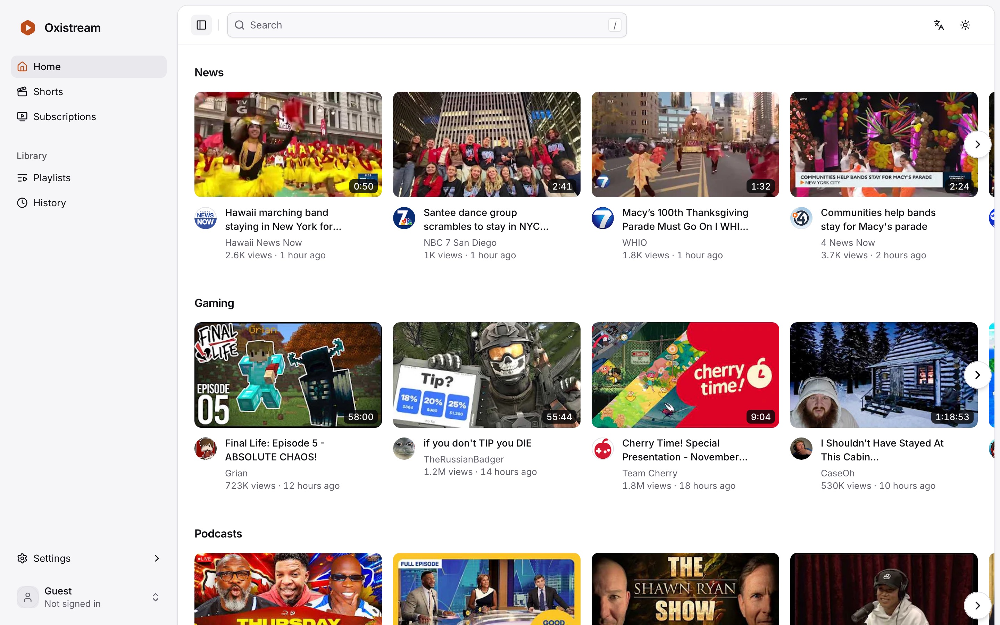

<p align="center">
  
</p>

<h1 align="center">Oxistream</h1>

A self-hosted, privacy-friendly YouTube frontend with accounts, subscriptions, playlists and watch parties. Built for homelabs, also suitable for public instances.

<picture>
  <source media="(prefers-color-scheme: dark)" srcset="docs/images/home-dark.jpg">
  
</picture>

Oxistream fetches everything from YouTube on the server and streams video, audio, thumbnails and subtitles through its own proxy. Browsers never talk to Google, and no YouTube account is used.

> Oxistream has not had a first release yet. Expect breaking changes.

## Features

- **Watching**: DASH player with all qualities, codecs and audio tracks, subtitles, chapters, a searchable transcript, keyboard shortcuts, sleep timer and loop. A mini player keeps playing while you browse.
- **Discovery**: search, channel pages, shorts player, a home page with continue watching, subscriptions and trending rows. URLs mirror YouTube's, so redirect extensions work.
- **Subscriptions**: a feed with filters (hide watched, hide shorts, per channel), subscription groups, new-upload markers and a private Atom feed. Import from YouTube Takeout, NewPipe, Invidious and Piped; export to NewPipe and Invidious.
- **Library**: local playlists (private or shared by link), followed YouTube playlists, an up-next queue synced across devices, watch history with resume, search and retention.
- **Watch together**: parties with an invite link, a shared queue, synchronized playback, chat and reactions. Guests can join without an account.
- **SponsorBlock**: segment markers, auto-skip or a skip button per category, looked up by the server.
- **Accounts**: local accounts and OpenID Connect (with back-channel logout), optional login requirement, account self-deletion and a small admin area.
- **Interface**: light and dark mode, English and German.
- **Operations**: one container image for amd64 and arm64 next to an external PostgreSQL database, support for multiple replicas, Prometheus metrics, health probes, Docker Compose and Helm.

## Quick start

```sh
cd deploy/compose
cp .env.example .env
# Set POSTGRES_PASSWORD and OXISTREAM_PROXY_SECRET in .env
docker compose up -d
```

Open `http://localhost:8080` and register. The first local account becomes the admin.

## Documentation

The [documentation](https://oxistream.github.io/oxistream/) ([source](docs/)) covers setup (Docker, Compose, Kubernetes), usage, configuration, administration, reverse proxies, authentication, replicas, privacy, the API, development, a FAQ and troubleshooting.

Deployment files live in [`deploy/compose`](deploy/compose/README.md) and [`deploy/helm/oxistream`](deploy/helm/oxistream/README.md). Release images are published as `ghcr.io/OWNER/oxistream`.

## Acknowledgements

YouTube data comes from [RustyPipe](https://codeberg.org/ThetaDev/rustypipe), via a maintained fork. Oxistream draws on ideas from [Invidious](https://invidious.io), [Piped](https://github.com/TeamPiped/Piped) and [NewPipe](https://newpipe.net). Skip segments come from [SponsorBlock](https://sponsor.ajay.app).

Oxistream is not affiliated with or endorsed by YouTube or Google.

## License

[AGPL-3.0-or-later](LICENSE)

## AI disclaimer

Large parts of Oxistream, including code, tests and documentation, were written with AI coding assistants. Every change is reviewed, tested and merged by a human maintainer, but please review the code with that in mind, and report anything that looks wrong.

## Star History

<a href="https://www.star-history.com/?repos=oxistream%2Foxistream&type=date&legend=bottom-right">
 <picture>
   <source media="(prefers-color-scheme: dark)" srcset="https://api.star-history.com/chart?repos=oxistream/oxistream&type=date&theme=dark&legend=top-left" />
   <source media="(prefers-color-scheme: light)" srcset="https://api.star-history.com/chart?repos=oxistream/oxistream&type=date&legend=top-left" />
   
 </picture>
</a>
