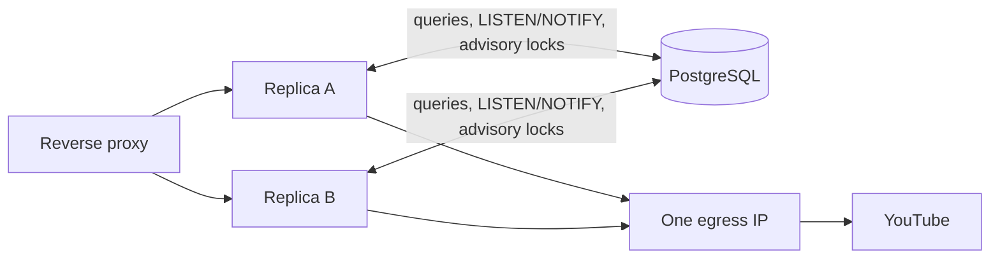

# Replicas and rate limiting

## Multiple replicas

Any replica can serve any request. They coordinate through PostgreSQL.

| Requirement | Why |
| --- | --- |
| Same `OXISTREAM_PROXY_SECRET` everywhere | Proxy URLs and the OIDC login cookie are HMAC-signed. A URL signed by one replica must verify on another. |
| One egress IP | YouTube binds stream URLs to the IP that requested them. Each replica resolves streams with its own player cache, so a replica only uses URLs it fetched itself. Replicas behind different IPs still look like several clients to YouTube. Different IPs also make blocks harder to diagnose. |
| NTP-synced clocks | Watch party positions (`position_at`) and pongs use each replica's wall clock. Clock skew between replicas adds to party drift. |
| Direct or session-mode database connections | The watch party listener uses `LISTEN`. Transaction-mode poolers (PgBouncer's default mode) break it. |
| Connection budget | Each replica opens up to `OXISTREAM_DATABASE_MAX_CONNECTIONS` (default 10) connections. |

What runs where:

| Task | Interval | Coordination |
| --- | --- | --- |
| Feed worker: channels and followed YouTube playlists | 1 min tick, each item every `OXISTREAM_FEED_INTERVAL_MINUTES` | Advisory lock: one replica per run. |
| History retention cleanup | hourly | Advisory lock. |
| Expired sessions and used back-channel logout `jti`s | hourly | Idempotent deletes, on every replica. |
| Watch party cleanup: stale participants (2 min without a heartbeat), rooms idle for 24 h | every 5 min | Any replica. |
| Watch party sync | on change | `LISTEN`/`NOTIFY` on `watch_rooms`, `watch_room_status`, `watch_room_chat`, `watch_room_reaction`. |

These caches are in memory, per replica:

- player responses
- trending pages (30 min)
- search suggestions (10 min)
- SponsorBlock segments (1 h; 15 min when empty; 1 min after errors)

Hit rates therefore drop with more replicas. Sticky sessions are not required.

## Rate limiting

On by default. `/api` and `/proxy` share a per-client-IP token bucket: 50 requests per second sustained, burst 200 (`OXISTREAM_RATE_LIMIT_PER_SECOND`, `OXISTREAM_RATE_LIMIT_BURST`). IPv6 clients are grouped by /64. Over the limit, the server answers 429 with `Retry-After`. Login and registration have [stricter limits](authentication.md#local-accounts).

A video playback makes many `/proxy` range requests. If clients see 429s during playback, raise the burst. Behind a reverse proxy, set `OXISTREAM_TRUSTED_PROXY_HEADER`, or all users share one bucket. See [Reverse proxy](reverse-proxy.md#client-ip).

Watch party WebSockets have their own per-connection limits.

