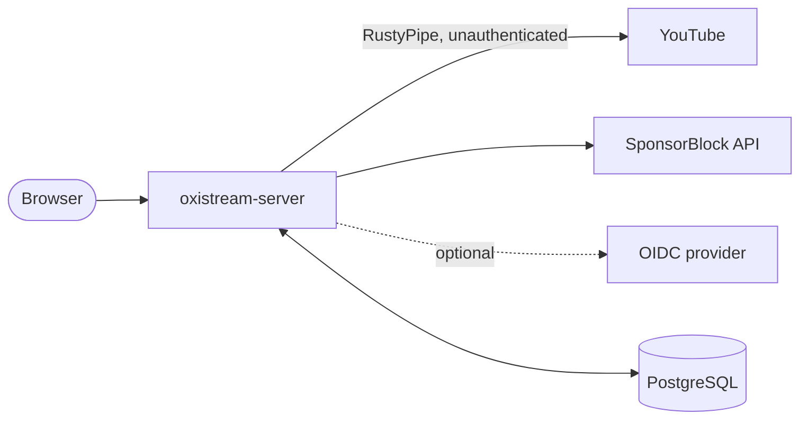
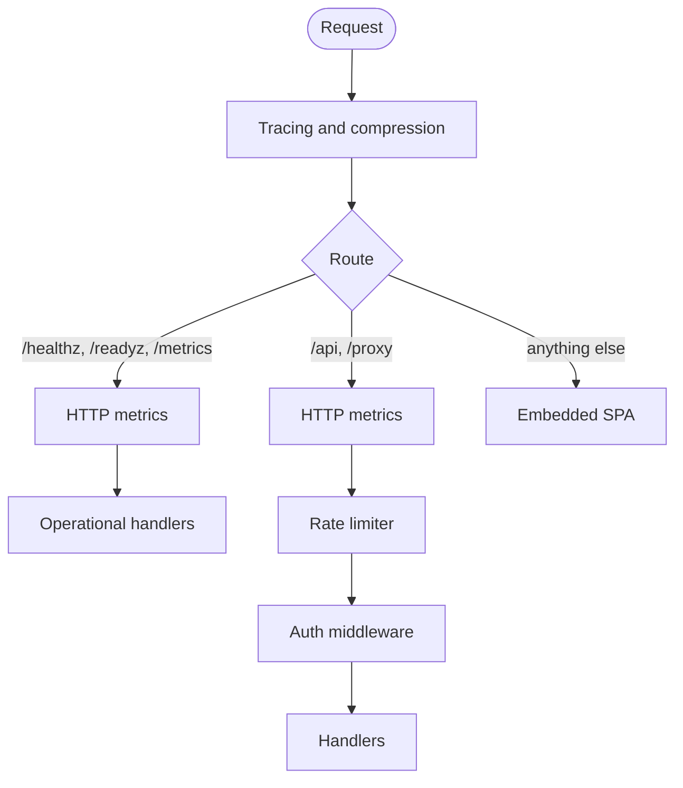
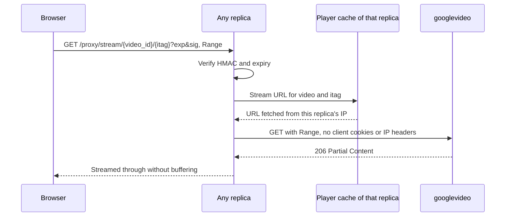
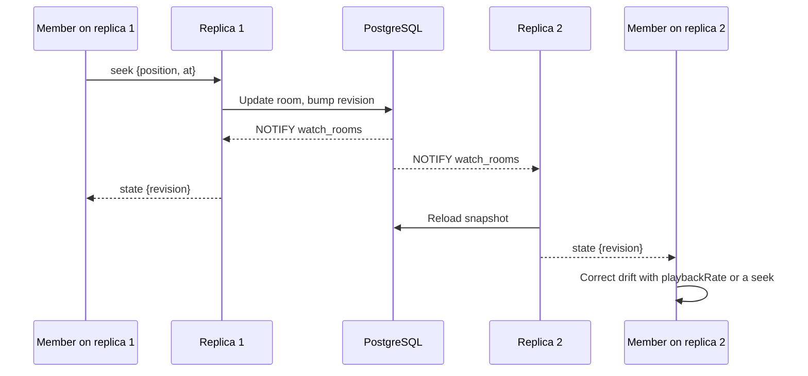

# Architecture

Oxistream is one binary. A Rust server (axum) serves an embedded SvelteKit SPA, a JSON API under `/api/v0`, and a media proxy under `/proxy`. All state lives in PostgreSQL, so replicas are interchangeable.

## Repository

| Path | Contents |
| --- | --- |
| `backend/crates/oxistream-server` | axum app: routes, auth, proxy, feed worker, watch parties, embedded SPA |
| `backend/crates/oxistream-dash` | Pure DASH MPD generator, no web or IO dependencies |
| `backend/crates/oxistream-db` | sqlx repositories behind traits, advisory locks |
| `backend/migrations` | SQL migrations, applied at startup |
| `backend/openapi.json` | Generated OpenAPI document, committed |
| `frontend/` | SvelteKit SPA (`adapter-static`), Svelte 5, Tailwind CSS 4, shadcn-svelte |
| `deploy/` | Compose setup and Helm chart |
| `nix/`, `flake.nix` | Dev shell and the `rustypipe-botguard` package |

## Request flow

The router stacks these layers, outermost first:

1. Tracing (request span; Atom feed tokens redacted) and compression (not for `video/*` and `audio/*`, so range requests keep working).
2. HTTP metrics per matched route.
3. For `/api` and `/proxy`: rate limiting per client IP, then the auth middleware. The auth middleware:
   - runs the Origin check for non-GET requests,
   - resolves the `oxistream_session` cookie to a user, renewing it at most every 5 min,
   - enforces `OXISTREAM_REQUIRE_LOGIN`, letting watch party guests with a valid `oxistream_party` cookie through.
4. Handlers. Unmatched GET requests outside `/api` and `/proxy` fall back to the embedded SPA (`index.html` for client-side routes).

`/healthz`, `/readyz` and `/metrics` sit outside the rate limiter and the auth middleware.

## YouTube access

- RustyPipe through the `oxipipe` fork, always `.unauthenticated()`. No accounts or cookies.
- `rustypipe-botguard` runs as a subprocess and provides PO tokens.
- Player responses are cached in memory per replica (moka), until shortly before their stream URLs expire. On an upstream 403 the proxy drops the entry and fetches it again once.
- In-memory caches with fixed lifetimes: trending pages (30 min), search suggestions (10 min).
- Video metadata is upserted into `videos` as a cache. Media is never stored.

## DASH manifests

YouTube provides no MPD for regular videos. `GET /api/v0/videos/{id}/manifest.mpd` builds one from the player response with `oxistream-dash`:

- A static, on-demand MPD with one Period. Each Representation uses `SegmentBase` with the stream's `init_range` and `index_range`. Streams without ranges (OTF) are skipped.
- One AdaptationSet per mime type and codec, and per audio track.
- Audio roles come from YouTube's `acont` tag (`main`, `dub`, `description`). Auto-dubs get an extra `<Role schemeIdUri="urn:oxistream:dash:role:2026" value="auto-dub"/>`, so the player never starts with one.
- Every `BaseURL` is a signed proxy URL.
- Subtitles are not part of the MPD. The player loads them separately as WebVTT through the proxy. Storyboards come from `GET /api/v0/videos/{id}/storyboard.vtt`.

Manifests are snapshot-tested with insta against fixture data.

## Stream proxy

| Route | Upstream |
| --- | --- |
| `/proxy/stream/{video_id}/{itag}?track=` | googlevideo stream, resolved from this replica's player cache |
| `/proxy/subtitle/{video_id}/{id}` | YouTube timed text, as VTT |
| `/proxy/image/{base64url(upstream URL)}` | thumbnails, avatars, banners |

URLs are stateless, signed with HMAC-SHA256: the query parameters `exp` and `sig` are keyed with `OXISTREAM_PROXY_SECRET`. Any replica can verify any URL. Stream and subtitle URLs name the video, not a googlevideo URL. Each replica therefore resolves them against its own player cache, and uses googlevideo URLs only from the IP that fetched them.

Image URL expiry is rounded up to the day, so URLs stay the same and browsers can cache them.

Upstream hosts are allowlisted per kind, over HTTPS only, and redirects are checked against the same list. Range requests pass through, and responses are streamed without buffering. Only `Content-Type`, `Content-Length`, `Content-Range` and `Accept-Ranges` are copied back. No client cookies or IP headers go upstream.

Some player clients return streams that only become valid after a pre-roll ad would have ended (`VideoPlayer::available_at`). The proxy waits for that moment, up to a bound.

## Feed worker

- A 1-minute tick fetches only channels and followed YouTube playlists that are due. Each item is fetched once per `OXISTREAM_FEED_INTERVAL_MINUTES`, however many users follow it.
- A new subscription or follow is fetched immediately.
- Uploads go into `channel_videos`. For followed playlists, only the first 500 items are stored, to count "new videos".
- Each run holds a PostgreSQL advisory lock, so only one replica fetches at a time.
- A run stops early when YouTube rate-limits, and records that for the status page.

The history retention cleanup works the same way: hourly, under its own advisory lock.

## SponsorBlock

`GET /api/v0/videos/{id}/segments` asks the configured API for `/api/skipSegments/{first 4 hex chars of sha256(id)}`, for all categories and the action types `skip`, `poi` and `full`. It keeps only the requested video.

Results are cached per video: 1 h, 15 min when empty, 1 min after errors. Upstream errors yield no segments, never a failed request.

Before an auto-skip, the frontend prefetches the fragments dash.js will request at the target and hands them over through a request interceptor, so the skip does not stall.

## Watch parties

Rooms are server-authoritative state in PostgreSQL (`watch_rooms`, `watch_room_queue`, `watch_room_participants`, `watch_room_messages`, `watch_room_seen`). Each room stores:

- the current entry,
- `playing`,
- `position_ms` plus `position_at`,
- permissions,
- autoplay,
- a `revision` that grows with every change.

Clients ignore states older than the revision they have.

- Transport: one WebSocket per participant, see [API](../api.md#watch-party-websocket). `ended` is compare-and-set on the current entry, so the queue advances once, however many clients report it.
- Replicas: triggers `NOTIFY watch_rooms` with the room ID on every revision bump and on delete. Every replica `LISTEN`s and reloads the snapshot for rooms it has connections to. Member status, chat and reactions use `watch_room_status`, `watch_room_chat` and `watch_room_reaction`. After a listener reconnect, all local rooms are reloaded.
- Clock: clients estimate the server clock NTP-style. They ping every 10 s (in a burst on join) and take the median offset of the 3 fastest of the last 10 pings. `play` and `seek` carry `at`, the server time the position was read (at most 5 s back), so latency does not put others behind.
- Drift correction (`frontend/src/lib/together/sync.ts`):
  - Drift under 1 s is made up with `playbackRate`: a P controller within ±5 %, keeping pitch, with a deadband.
  - Larger drift seeks ahead by a learned seek lead.
  - Buffering is waited out.
- WebKit freezes playback for about 300 ms on every `playbackRate` change. The controller measures that cost at runtime and keeps it in localStorage. Above 80 ms, it corrects in rare, bounded phases instead of continuously. There are no user-agent checks.
- User vs. automatic seeks (`party-sync.svelte.ts`): seeks the sync did not make are reported as the user's, on release while dragging. Without recent pointer or key input, seeks while stalled, right after our own seek, or to the end count as dash.js seeks and are not broadcast.
- Cleanup: participants heartbeat every 30 s and are dropped after 2 min. Rooms expire after 24 h without activity. Cleanup runs every 5 min.

`?debug=sync` on the watch page shows a sync readout.

## Frontend

- SPA built with `adapter-static` and embedded in the binary with `rust-embed` (`embed-frontend` feature).
- API types are generated from `openapi.json` (openapi-typescript). Requests go through `openapi-fetch` and TanStack Svelte Query.
- i18n uses Paraglide JS (English and German).
- Player: Video.js 10 with `<dash-video>` (dash.js). Codec and quality preferences become dash.js settings.

### App-wide player

`frontend/src/lib/player/app-player.svelte.ts` holds the single player instance. The app shell renders it once and never moves it in the DOM, because Video.js tears down on disconnect.

- The watch page loads videos into it and marks a slot (`appPlayer.slot()`), and the player is positioned over that slot.
- Without a slot, it is the mini player.
- It is hidden and paused on shorts pages. A party video plays on there, muted, in the mini player.
- `appPlayer.take(owner)` claims the player exclusively, which watch parties use. Pages then cannot load other videos, and `onnext`/`onprevious` replace the queue's next and previous.
- `appPlayer.next()` plays the up-next queue first, then the playlist it interrupted. `previous()` restarts the video after 3 s, otherwise goes to the playlist or tab history.

The up-next queue (`queue.svelte.ts`) is stored on the server for signed-in users (`/api/v0/queue`) and cached in localStorage. For guests it lives only in localStorage. Tabs share it either way.
